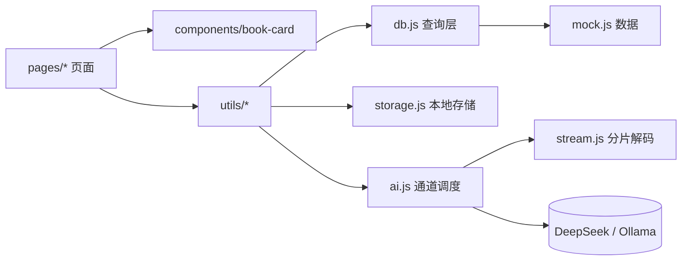

<div align="center">

# 拾光书店 · Shiguang Bookstore

**微信原生小程序 · 图书电商 + AI 流式推荐官**

[](https://github.com/TiTi-11/shiguang-bookstore/actions/workflows/ci.yml)
[](LICENSE)
[](https://developers.weixin.qq.com/miniprogram/dev/framework/)
[](CONTRIBUTING.md)

一个开箱即跑的图书电商小程序，外加一个**真正接大模型流式输出**的 AI 推荐官。<br/>
零后端依赖，导入微信开发者工具即可完整演示。

[功能](#-功能) · [界面预览](#-界面预览) · [快速开始](#-快速开始) · [AI 配置](#-ai-推荐官配了三档通道) · [架构](#-架构) · [测试](#-测试)

</div>

---

## 📖 关于

`shiguang-bookstore` 是一个用**微信原生小程序**写的作品项目，目标是把一个电商小程序的完整链路讲清楚：

浏览 → 搜索 → 详情 → 购物车 → 下单 → 订单，再加上一层 **AI 图书推荐官**。

技术上想验证一件事：**在小程序里能不能做出接近 ChatGPT 的流式体验**。
答案是能 —— 用 `wx.request` 的 `enableChunked` 配合 `onChunkReceived`，自己处理分片与 UTF-8 边界，
就能做到逐字输出、可中断、可降级。

> A WeChat Mini Program demo: full e-commerce flow + an LLM-powered recommendation assistant
> with real token-by-token streaming. No backend required.

---

## ✨ 功能

<table>
<tr><td width="50%" valign="top">

### 🛒 商城
- 首页：搜索入口、轮播、活动公告、12 个分类、猜你喜欢、推荐好书
- 分类：左右联动 + 综合 / 销量 / 价格 / 评分四种排序
- 搜索：实时搜索、搜索历史、热门词
- 详情：划线价、评分、标签、库存、简介、同类好书
- 购物车：全选、数量加减（1–99）、删除、清空、满 ¥99 包邮
- 下单：收货信息校验、运费计算、订单号生成
- 订单 / 收藏 / 我的：状态筛选、批量加购、本地登录

</td><td width="50%" valign="top">

### 🤖 AI 图书推荐官
- 用自然语言说需求，AI 给出 2–3 本书 + 推荐理由
- **逐字流式输出**，可随时中断
- 回答结束后渲染可点击的图书卡片
- **三档通道自动降级**：云端 → 本地 → 离线规则，演示永不翻车
- 支持快捷提问、清空对话

</td></tr>
</table>

---

## 📱 界面预览

> 📸 截图准备中。拍摄清单与命名见 [docs/screenshots.md](docs/screenshots.md)，
> 放好截图后把下面这段注释去掉即可显示。

```markdown
<!-- 截图就位后删除首尾注释
| 首页 | 分类 | 详情 |
| :---: | :---: | :---: |
|  |  |  |

| 购物车 | AI 推荐官 | 下单成功 |
| :---: | :---: | :---: |
|  |  |  |
-->
```

---

## 🚀 快速开始

```bash
# 1. 克隆
git clone https://github.com/TiTi-11/shiguang-bookstore.git

# 2. 用微信开发者工具「导入项目」，选择该目录
#    AppID 选「测试号」即可（project.config.json 已设为 touristappid）

# 3. 顶部菜单：详情 → 本地设置
#    ✅ 勾选「不校验合法域名、web-view（业务域名）、TLS 版本以及 HTTPS 证书」
#    ✅ 调试基础库 ≥ 2.20.1（流式 onChunkReceived 的最低要求）

# 4. 编译运行，无需启动任何后端
```

**环境要求**

| 项 | 要求 |
| --- | --- |
| 微信开发者工具 | 1.06 及以上 |
| 调试基础库 | ≥ 2.20.1（流式能力） |
| Node.js（仅测试用） | ≥ 18 |

---

## 🤖 AI 推荐官配置

配置在 `utils/config.js`：

```js
ai: {
  mode: 'auto',                                   // auto | cloud | local | rule
  cloud: { baseUrl: 'https://api.deepseek.com', apiKey: '', model: 'deepseek-chat' },
  local: { baseUrl: 'http://127.0.0.1:11434', model: 'qwen2.5' },
  timeout: 30000
}
```

| 通道 | 说明 | 如何启用 |
| --- | --- | --- |
| `cloud` | OpenAI 兼容接口，SSE 流式 | 填 `cloud.apiKey` |
| `local` | 本地 Ollama，JSONL 流式 | `ollama serve` + `ollama pull qwen2.5` |
| `rule` | 离线规则推荐，按关键词匹配分类 | 无网络 / 无模型时自动使用 |

`mode: 'auto'` 时的选择顺序：**有云端 Key → 云端；否则 → 本地；任一失败 → 离线规则**。

> ⚠️ 真实 Key 只放本地，**不要提交**。`.gitignore` 已忽略 `utils/config.local.js`。
> 本地调试 Ollama 时，需在开发者工具中勾选「不校验合法域名」。

---

## 🧱 架构



**核心约定**

- 页面不直接读数据源，统一走 `utils/db.js`
- 页面不直接调 `wx.setStorageSync`，统一走 `utils/storage.js`
- 换真实后端只需改 `db.js` 内部实现，页面零改动

详见 [docs/architecture.md](docs/architecture.md)（含时序图与降级状态机）。

```text
shiguang-bookstore/
├─ app.js / app.json / app.wxss        # 入口与全局样式
├─ components/book-card/               # 图书卡片（网格 / 列表双形态）
├─ pages/                              # 12 个页面
│  ├─ index  category  detail
│  ├─ cart  checkout  result
│  ├─ search  ai
│  └─ orders  favorites  profile  login
├─ utils/
│  ├─ config.js    门店 / 运费 / AI 通道配置
│  ├─ mock.js      示例数据（12 分类 / 32 本图书）
│  ├─ db.js        查询层
│  ├─ storage.js   本地存储封装
│  ├─ cart.js  fav.js  order.js  user.js
│  ├─ stream.js    UTF-8 分片解码 + 行缓冲
│  └─ ai.js        三通道 + 降级
├─ tests/          静态检查与逻辑测试
├─ docs/           截图与架构文档
└─ .github/        CI、Issue / PR 模板
```

---

## 🔍 关键实现

### 1. 中文分片解码（最容易被忽略的坑）

网络分片边界常常正好切在中文字符中间，直接 `String.fromCharCode` 会出乱码：

```js
// utils/stream.js
if (i + need >= bytes.length) break   // 尾部不完整，留到下一块
pending = bytes.slice(i)
```

### 2. 三通道调度 + 无感降级

```js
ai.ask({
  question, history,
  onMode,    // cloud / local / rule，用于界面提示
  onDelta,   // 增量文本
  onDone,    // 结束，返回最终通道
  onError,   // 出错
  onReset    // 降级前清空半截内容
})
```

### 3. 组件双形态

```html
<book-card book="{{item}}" mode="grid" bind:tap="goDetail" />
<book-card book="{{item}}" mode="list" bind:tap="goDetail" />
```

---

## ✅ 测试

```bash
npm run check   # 静态检查：JSON、页面四件套、组件、图片、跳转目标
npm test        # 业务逻辑测试：搜索、购物车、订单、收藏、AI 降级链路
npm run verify  # 两者一起跑（CI 用的是这个流程）
```

测试在 Node 中模拟 `wx` 环境，直接跑真实的 `utils/*` 代码，不依赖开发者工具。
共 **28 项断言**，覆盖金额计算、包邮规则、订单号格式、AI 降级与书目解析等。

CI 见 [.github/workflows/ci.yml](.github/workflows/ci.yml)。

---

## 🗺 Roadmap

- [x] 商城完整链路（浏览 / 搜索 / 购物车 / 下单 / 订单）
- [x] AI 流式推荐 + 三通道降级
- [x] 静态检查与逻辑测试
- [ ] AI 推荐支持「按预算 / 按阅读时长」筛选
- [ ] 接入真实后端（`db.js` 换成 `wx.request`）
- [ ] 微信支付（`wx.requestPayment` 替换本地模拟）
- [ ] 商品评价与晒图
- [ ] 订阅消息：发货提醒

---

## 🤝 贡献

欢迎 Issue 与 PR。动手前请先看 [CONTRIBUTING.md](CONTRIBUTING.md)，
提交信息建议遵循 [Conventional Commits](https://www.conventionalcommits.org/zh-hans/)。

## 📄 License

[MIT](LICENSE) © 2026 TiTi

---

<div align="center">
<sub>图书信息与销量均为示例数据，封面由脚本生成，不含第三方版权素材。</sub>
</div>
