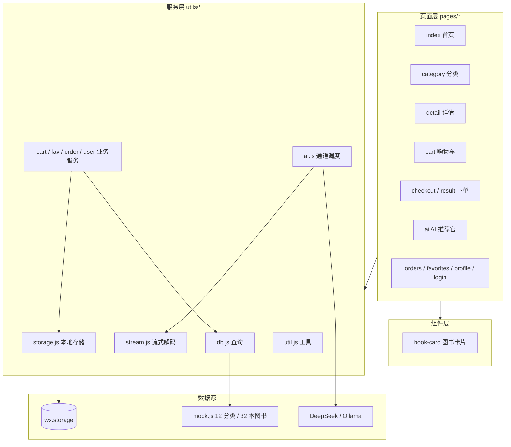
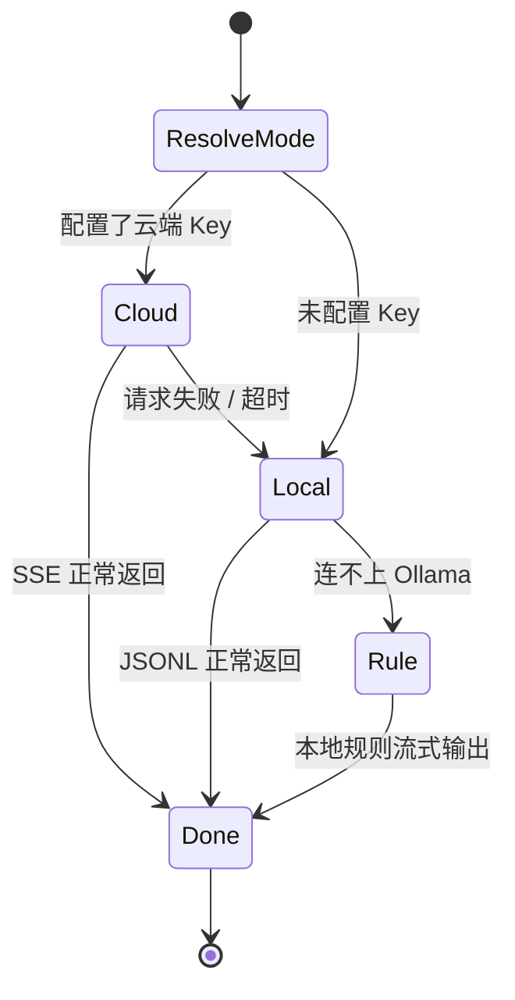
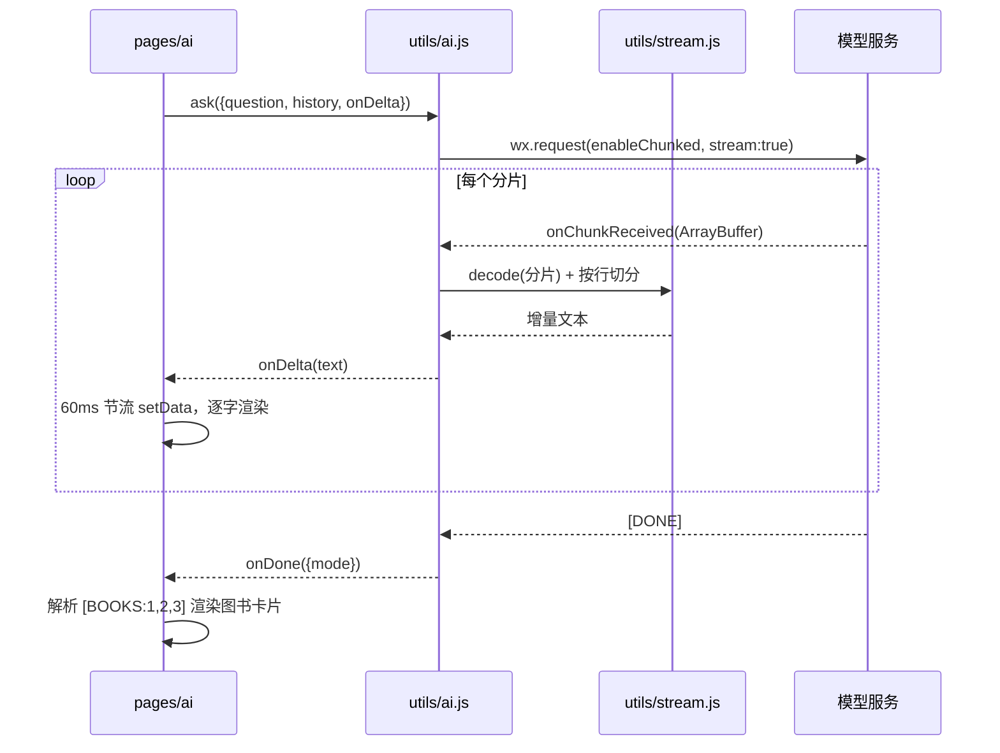

# 架构说明

## 分层



**约定**：页面不直接读 `mock.js`，也不直接调 `wx.setStorageSync`。
换真实后端时，只需把 `db.js` 内部实现改成 `wx.request`，页面零改动。

## AI 三条通道



- **cloud**：OpenAI 兼容接口（DeepSeek），`data: {...}` SSE 分帧
- **local**：Ollama `/api/chat`，每行一个 JSON
- **rule**：关键词 → 分类 → 高分书，仍按流式节奏输出，保证演示可用

## 一次流式问答的时序



## 为什么需要自己解 UTF-8

`onChunkReceived` 给的是 `ArrayBuffer`，中文一个字 3 字节，网络分片边界常常正好切在字符中间。
`String.fromCharCode` 逐字节转换会出乱码，因此 `utils/stream.js` 实现了带残留缓冲的解码器：

```js
if (i + need >= bytes.length) break   // 尾部不完整，留到下一块
pending = bytes.slice(i)
```
